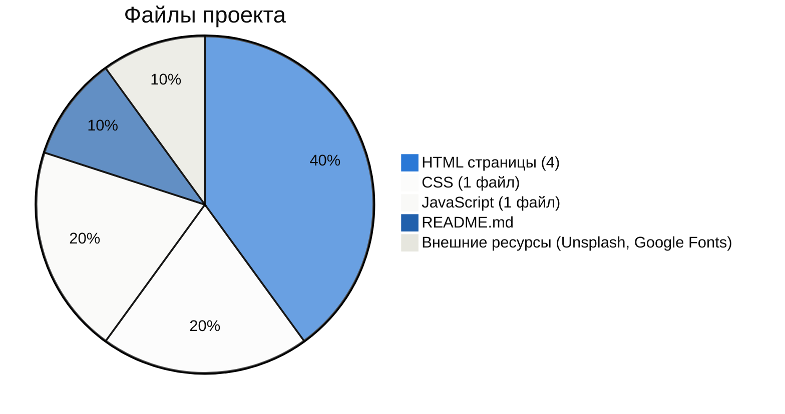
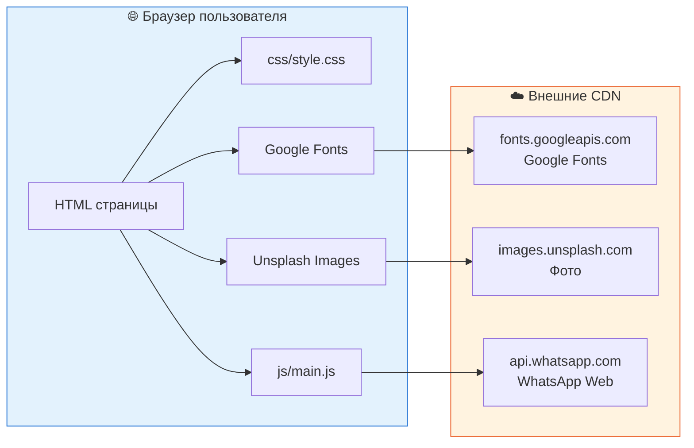
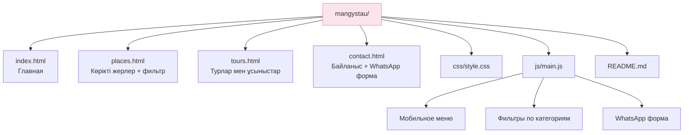
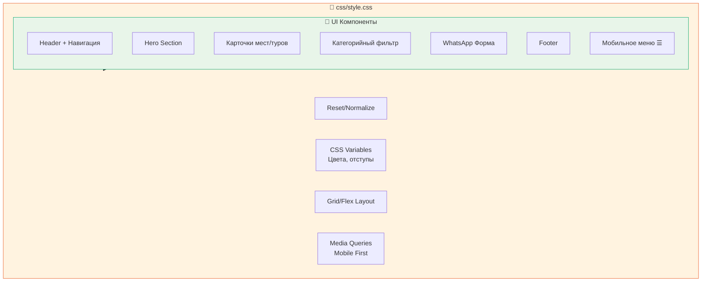
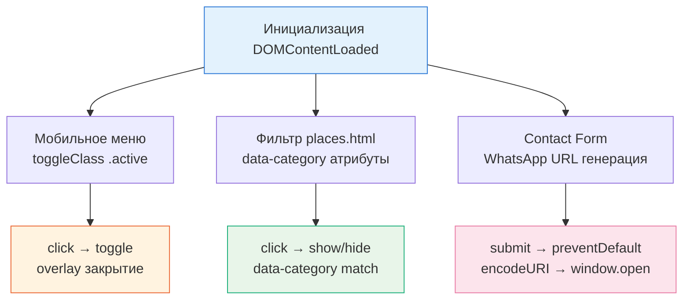
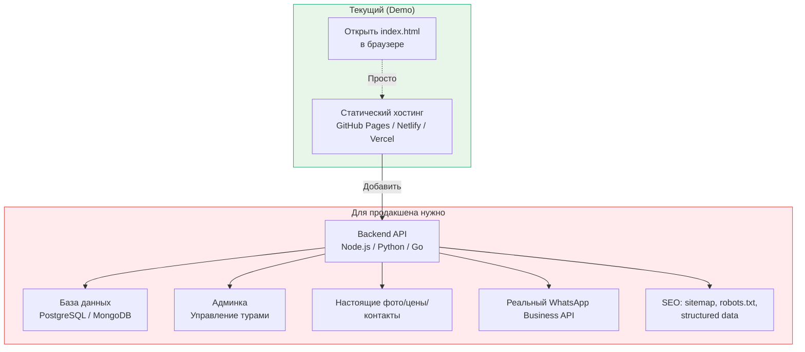
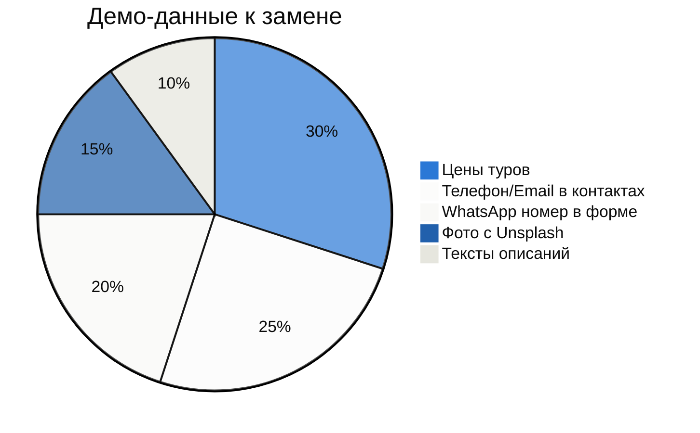
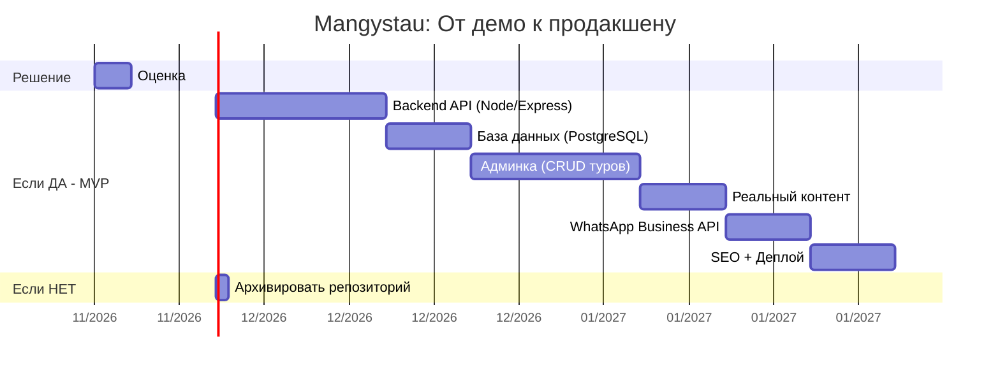

# mangystau — Графический обзор

> **Статус:** Демо/Прототип | **Тип:** Статический фронтенд (ландинг) | **Приоритет:** ⭐⭐

---

## 📊 Метрики проекта



---

## 🏗️ Архитектура (только клиентская)



> ⚠️ **Нет бэкенда, нет БД, нет серверного рендеринга** — чисто статический сайт.

---

## 📁 Структура проекта



---

## 📱 Страницы и функционал

```mermaid
%%{init: {'theme': 'base', 'themeVariables': {'primaryColor': '#2a78d6', 'primaryTextColor': '#0b0b0b', 'primaryBorderColor': '#c3c2b7', 'lineColor': '#c3c2b7', 'secondaryColor': '#fcfcfb', 'tertiaryColor': '#f9f9f7'}}}%%
quadrantChart
    title Страницы: Готовность vs Сложность
    x-range 0 1
    y-range 0 1
    quadrant-1 "Сложные, готовые"
    quadrant-2 "Простые, готовые"
    quadrant-3 "Простые, не готовые"
    quadrant-4 "Сложные, не готовые"
    "index.html": [0.3, 0.9]
    "places.html": [0.5, 0.8]
    "tours.html": [0.4, 0.7]
    "contact.html": [0.6, 0.6]
```

| Страница | Описание | JS функционал | Статус |
|----------|----------|---------------|--------|
| **index.html** | Hero, особенности, отзывы, CTA | Мобильное меню | ✅ Готово |
| **places.html** | Каталог мест, фильтр по категориям | Категорийный фильтр | ✅ Готово |
| **tours.html** | Карточки туров, цены, кнопки | Мобильное меню | ⚠️ Цены — демо |
| **contact.html** | Форма, карта, контакты | WhatsApp генерация | ⚠️ Номер — демо |

---

## 🎨 UI компоненты



---

## 📋 JavaScript функционал (js/main.js)



**WhatsApp ссылка формат:**
```javascript
const url = `https://wa.me/${phone}?text=${encodeURIComponent(message)}`;
window.open(url, '_blank');
```

---

## 🚀 Деплой варианты



---

## ⚠️ Что нужно заменить перед запуском



| Элемент | Где находится | Что сделать |
|---------|---------------|-------------|
| Цены | tours.html | Заменить на реальные |
| Телефон | contact.html, footer | Настоящий номер |
| Email | contact.html | Рабочий email |
| WhatsApp | js/main.js + contact.html | Бизнес-номер WhatsApp |
| Фото | Все HTML (data-src) | Свои фото или платный сток |
| Описания | places.html, tours.html | Уникальные тексты |

---

## 🎯 Рекомендации по развитию



---

## ⚡ Быстрые команды для ИИ

```bash
# Просто открыть в браузере (нет сборки)
# Windows:
start index.html

# Mac/Linux:
open index.html
# или
xdg-open index.html

# Деплой на GitHub Pages (если решите оставить статику):
# 1. Push в GitHub
# 2. Settings → Pages → Deploy from branch → main
# 3. Сайт будет на https://username.github.io/mangystau/

# Деплой на Netlify (drag & drop папку mangystau)
# Деплой на Vercel: npx vercel --prod
```

---

## 📊 Сравнение с другими проектами

```mermaid
%%{init: {'theme': 'base', 'themeVariables': {'primaryColor': '#2a78d6', 'primaryTextColor': '#0b0b0b', 'primaryBorderColor': '#c3c2b7', 'lineColor': '#c3c2b7', 'secondaryColor': '#fcfcfb', 'tertiaryColor': '#f9f9f7'}}}%%
quadrantChart
    title Mangystau vs Другие проекты
    x-range 0 1
    y-range 0 1
    quadrant-1 "Сложные, продакшн"
    quadrant-2 "Простые, продакшн"
    quadrant-3 "Простые, демо"
    quadrant-4 "Сложные, демо"
    "Шешен сөз": [0.9, 0.95]
    "BilimAI": [0.8, 0.8]
    "desktop-tutorial": [0.1, 0.1]
    "Mangystau": [0.2, 0.3]
```

---

## 🎯 Приоритеты (если развиваем)

| # | Задача | Сложность | Время | Блокеры |
|---|--------|-----------|-------|---------|
| 1 | **Принять решение: развивать/архивировать** | 🟢 Низкая | 1 день | Бизнес-решение |
| 2 | Backend API + БД | 🔴 Высокая | 2-3 недели | Нужен стек |
| 3 | Админка управления контентом | 🔴 Высокая | 2 недели | Backend готов |
| 4 | Настоящий контент (фото, цены, тексты) | 🟡 Средняя | 1 неделя | Контент-менеджер |
| 5 | WhatsApp Business API | 🟡 Средняя | 3-5 дней | Номер, верификация |
| 6 | SEO + Аналитика | 🟢 Низкая | 2 дня | Деплой готов |

---

*Создано: 2026-11-22 | Для быстрого контекста ИИ при работе с проектом*